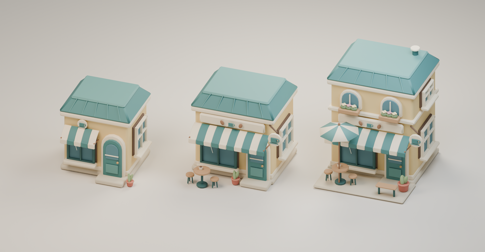
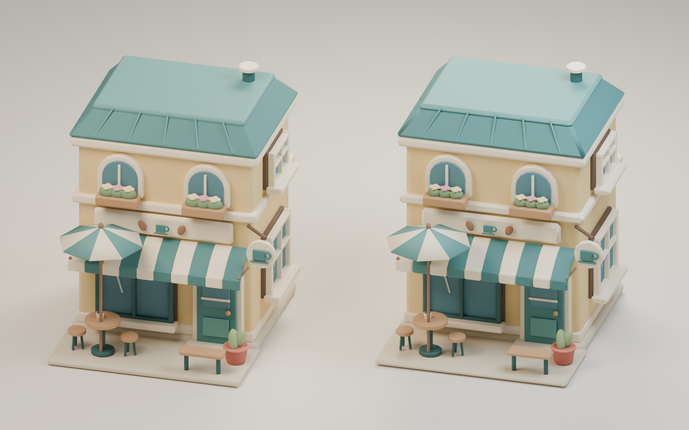

# 차곡마을 카페 업그레이드 1~3단계 — v002

2026-11-09 제작. v001의 따뜻한 버터색 벽, 청록색 지붕과 줄무늬 차양, 둥근 미니어처 형태를 유지했다. 기존 `town_miniature_v001`의 26개 파일은 제작 시작 때의 SHA-256과 동일하며 덮어쓰지 않았다.



## 단계별 변화

| 단계 | 외형 | 런타임 모델 | 재가져온 모델의 렌더 |
| --- | --- | --- | --- |
| 1 | 작은 테이크아웃점. 작은 차양, 커피잔 표식, 화분 | [1단계 GLB](exports/cafe_level_1.glb) | [PNG](renders/cafe_level_1.png) |
| 2 | 넓어진 매장과 차양, 돌출 커피잔 표식, 야외 테이블·의자 | [2단계 GLB](exports/cafe_level_2.glb) | [PNG](renders/cafe_level_2.png) |
| 3 | 위층·아치창·꽃상자, 앞 테라스·파라솔·벤치 | [3단계 GLB](exports/cafe_level_3.glb) | [PNG](renders/cafe_level_3.png) |

알파벳·숫자·메뉴 문구를 모델에서 제거했다. 글자 대신 커피잔과 원두 모양만 사용한다. FONT 객체와 문자 이미지 텍스처는 없다. 비교 이미지에서 왼쪽부터 1→2→3단계이며, 모두 동일한 축척·시점으로 배치했다.

## 경량화 전후 — 같은 디자인끼리 비교

아래 '전'은 각 단계의 동일한 구성으로 만든 편집용 고밀도 모델이다. '후'는 실제 납품 GLB를 다시 가져온 모델이다. 단순히 작은 1단계와 큰 3단계의 수치를 비교한 것이 아니다.

| 단계 | 삼각형 전 → 후 | 감소 | 메시 전 → 후 | 재질 전 → 후 | GLB 바이트 전 → 후 |
| --- | ---: | ---: | ---: | ---: | ---: |
| 1 | 15,100 → **3,452** | **77.14%** | 59 → **1** | 15 → **1** | 436,108 → **183,844** |
| 2 | 24,944 → **5,248** | **78.96%** | 89 → **1** | 16 → **1** | 708,392 → **279,804** |
| 3 | 40,280 → **7,456** | **81.49%** | 147 → **1** | 19 → **1** | 1,118,204 → **402,204** |

각 단계의 파일 크기는 약 180 / 273 / 393 KiB다. GLB는 Draco·Meshopt 압축을 적용하지 않은 기본 glTF 2.0 파일이다.

기존 v001 카페는 **26,232 triangles / 97 meshes / 17 materials / 1,385,572 bytes**였다. 가장 가까운 외형인 v002의 2단계는 **삼각형 약 80.0%, 파일 크기 약 79.8% 감소**했다. v001과 v002는 문자·일부 장식 구성이 달라 이 수치는 버전 간 비교이며, 순수 최적화 효과는 위 동일 디자인 표를 기준으로 본다.



3단계의 같은 디자인 비교다. 왼쪽은 고밀도 편집본, 오른쪽은 경량 GLB 재가져오기 결과다. 작은 꽃과 아치 외곽은 세분화를 줄여 약간 각져지고, 큰 지붕·벽 모서리는 둥근 형태를 유지한다.

## 경량화 방법과 런타임 조건

- 큰 모서리 bevel은 2분할, 작은 모서리는 1분할로 축소. 가는 막대의 보이지 않을 정도로 작은 끝 bevel 제거.
- 원통·구·커피잔 손잡이·작은 꽃의 분할 수를 줄임. 둥근 표면의 노멀은 유지.
- 색을 `COLOR_0` 정점 색으로 저장하고, 모델별 **메시 1개 / material 1개 / glTF primitive 1개**로 병합.
- 재질은 불투명, 금속성 0, 거칠기 0.68. 외부 텍스처·투명 유리·광원·카메라·애니메이션을 GLB에 포함하지 않음.
- 뒷면 컬링 사용. 아치 메시의 앞뒤 방향을 점검했고 실제 내보낸 재질의 `doubleSided=false`, `alphaMode=OPAQUE`를 확인.
- 모델 색을 표시하려면 가져오는 쪽에서 glTF의 `COLOR_0`을 유지해야 한다. 임의로 재질을 교체하면서 정점 색을 무시하면 색이 사라진다.

primitive 1개는 렌더링 제출 구조의 수치다. 그림자·깊이·추가 패스가 있는 실제 엔진에서 전체 draw call이 반드시 1회라는 뜻은 아니다. 측정한 것은 메시와 파일의 비용이며, 차량 프레임 속도·GPU 메모리 사용량·발열은 아직 측정하지 않았다.

## 편집 원본과 배치

[chagok_cafe_upgrades_v002.blend](blend/chagok_cafe_upgrades_v002.blend)에 7개 장면이 있다.

- `01 • Cafe upgrades`: 납품용 경량 모델 세 단계 비교.
- `EDIT • level 1/2/3`: 지붕·벽·문·창·차양·테이블·꽃상자 등을 분리한 편집용 고밀도 원본.
- `RUNTIME • level 1/2/3`: 병합된 경량 모델.

편집 원본을 변경해도 병합본이 자동으로 갱신되지는 않는다. 재생성할 변경은 제작 스크립트에 반영하거나, 수동 편집 후 병합·정점 색 저장·내보내기 단계를 다시 거쳐야 한다. 색은 [palette.json](reports/palette.json)에 정리했다.

Blender 기준 1 unit=1 m, 위쪽 +Z, 정면 -Y. 세 단계 모두 건물 중심의 바닥이 루트 (0,0,0)이며 scale=(1,1,1)이다. GLB는 Y-up으로 저장되고 Blender 재가져오기 시 원래 축으로 돌아온다.

세 단계의 모든 돌출 부분을 수용하는 공통 배치 구역은 **4.8×4.8 m**다. 건물 중심을 그대로 유지하면서 앞쪽 테라스가 자라므로, 루트 기준 XY 범위는 **(-2.4, -3.2)~(2.4, 1.6)**로 앞쪽에 더 여유를 둔다. 루트 중심으로 ±2.4 m인 정사각형을 뜻하지 않는다. GLB의 extras에도 이 범위를 기록했다. 실제 최고 높이는 각각 약 3.02 / 3.27 / 4.69 m다.

## 검증

- 새 `.blend` 저장·재열기, 장면 7개와 FONT 객체 0개 확인.
- GLB 3개를 각각 빈 장면으로 재가져오기. 메시·재질·삼각형 수, 정점 색 다양성, 바닥 높이·루트 축척과 바운딩박스 확인.
- 최종 재가져오기와 원본 경량 모델의 바운딩박스·바닥 차이: 검사 정밀도에서 0.
- 단계 비교, 3개 개별 모델, 3단계 뒷면, 동일 디자인 경량화 전후 렌더를 실제로 열어 확인.
- v001 파일 26개 해시 일치 확인. Android 코드와 기존 캐릭터/마을 에셋은 변경하지 않음.
- 이번 결과는 **모델 경량화 및 파일 검증**이다. Android/Pleos/실차 실행·성능 또는 제품 아키텍처 전환은 수행하지 않았다.

원자료: [optimization.json](reports/optimization.json), [validation.json](reports/validation.json), [보존 해시](reports/v001_preservation.json). 비교용 고밀도 GLB는 `reports/reference/`에 보존했다. 배포 후보는 `exports/`의 세 파일이다.

## 재현

[build_cafes.py](source/build_cafes.py)는 Blender 모델·GLB·통계를 생성하고, [render_verify.py](source/render_verify.py)는 재열기·재가져오기·보존 검증과 렌더를 수행한다. Blender 5.2.3 LTS, Cycles 64 samples / denoise, RTX 3060 OptiX로 렌더했다. 대표 비교는 2400×1250, 개별·뒷면은 1200×1200, 경량화 비교는 2000×1250이다.

```powershell
$blender = 'C:/Users/hy/AppData/Local/Programs/Blender Foundation/blender-5.2.3-windows-x64/blender.exe'
& $blender --background --python 'D:/Project/Etc/ChagokTown/art/town_cafe_v002/source/build_cafes.py'
& $blender --background --python 'D:/Project/Etc/ChagokTown/art/town_cafe_v002/source/render_verify.py'
```

재생성은 v002의 생성 산출물을 덮어쓴다. 수동 편집본은 별도 이름으로 보존한다. v001 파일은 읽기만 하며 제작 최초의 해시가 달라지면 빌드를 중단한다. `renders/preview_levels.png`는 구도 조정 전 중간 시안이고 최종 대표 이미지는 `01_cafe_levels.png`다.
