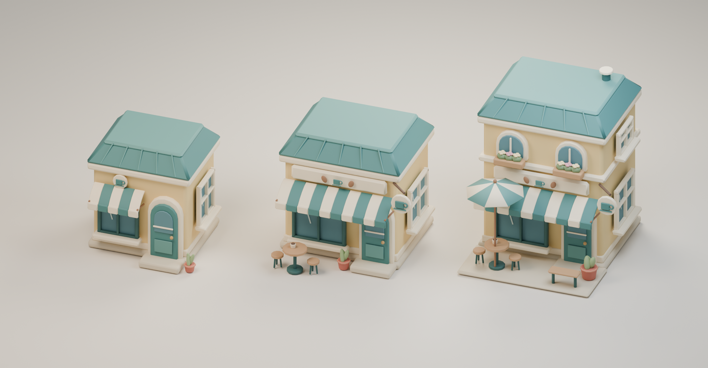

# 카페 v003 — 창문 갈색 받침판 제거

2026-11-09. v002 카페 1~3단계의 창문 뒤 갈색 프레임/몰딩만 제거한 수정본이다.



## 수정 범위

`window()`에서 생성하던 `Window • shadow recess`라는 갈색 받침판을 삭제했다. 1단계 2개, 2단계 2개, 3단계 3개다. 유리, 밝은 아이보리 창틀과 창턱, 정면의 청록 창틀은 유지했다. 창문과 무관한 나무 테이블·의자·꽃상자·차양 지지대·간판 지지대는 그대로다.

원본의 남은 부품마다 평가된 삼각형 좌표·재질·변환을 v002와 비교해 일치를 확인했다. 단계별 형태, 카메라·조명·모델 배치도 동일하다. 검사 원자료는 [scope_validation.json](reports/scope_validation.json)이다. [v002 비교 렌더](../town_cafe_v002/renders/01_cafe_levels.png)와 같은 구도로 볼 수 있다.

## 산출물

- [Blender 원본](blend/chagok_cafe_upgrades_v003.blend): 전체 비교 장면 1개, 부품별 편집 장면 3개, 경량 모델 장면 3개.
- GLB: [1단계](exports/cafe_level_1.glb), [2단계](exports/cafe_level_2.glb), [3단계](exports/cafe_level_3.glb).
- 재가져온 GLB 개별 렌더: [1단계](renders/cafe_level_1.png), [2단계](renders/cafe_level_2.png), [3단계](renders/cafe_level_3.png).
- [같은 구도의 단계 비교](renders/01_cafe_levels.png).
- 소스: [제작](source/build_cafes.py), [재가져오기·렌더 검증](source/render_verify.py), [수정 범위 검증](source/verify_scope.py).

## 내보내기·재가져오기 결과

| 단계 | 삼각형 v002 → v003 | GLB 정점 | 메시 / 재질 / primitive | 정점 색 종류 | 파일 크기 |
| --- | ---: | ---: | --- | ---: | ---: |
| 1 | 3,452 → **3,364** | 3,562 | 1 / 1 / 1 | 14 | 178,564 bytes |
| 2 | 5,248 → **5,160** | 5,498 | 1 / 1 / 1 | 16 | 274,524 bytes |
| 3 | 7,456 → **7,324** | 7,925 | 1 / 1 / 1 | 19 | 394,284 bytes |

- `.blend` 재열기와 GLB 3종의 빈 장면 재가져오기 통과. 실제 GLB를 불러온 개별 렌더 3장과 단계 비교 렌더를 열어 확인했다.
- `COLOR_0` 정점 색 유지, 텍스처 0개, 불투명·뒷면 컬링 유지. 문자 객체와 갈색 창문 받침판 객체는 0개다.
- 삼각형 수·메시/재질 수 일치. 경량 원본과 재가져온 모델의 바운딩박스 및 바닥 오차는 검사 정밀도에서 0.
- 1단계 정점 색 종류가 15→14로 줄어든 것은 해당 단계에서 갈색 받침판에만 사용하던 색이 빠졌기 때문이다. 2·3단계의 커피·간판 지지대 등 같은 갈색을 쓰는 소품은 남아 있다.
- v001의 26개 파일, v002의 25개 파일 SHA-256 일치 확인. 두 버전은 보존했다.

검사 결과: [validation.json](reports/validation.json). 상세 정점·재질·파일 수치: [optimization.json](reports/optimization.json). 이 파일의 `before`는 v003의 고밀도 편집 원본을 의미하며, v002와의 변화는 위 표를 따른다.

축척·루트·배치 구역·재질 사용법은 v002와 같다. Blender 기준 1 unit=1 m, +Z 위, 정면 -Y, 루트 (0,0,0). GLB는 Y-up. 공통 배치 XY 구역은 (-2.4,-3.2)~(2.4,1.6)이다. 모델 색을 표시할 때 `COLOR_0`을 유지한다.

## 재현

```powershell
$blender = 'C:/Users/hy/AppData/Local/Programs/Blender Foundation/blender-5.2.3-windows-x64/blender.exe'
& $blender --background --python 'D:/Project/Etc/ChagokTown/art/town_cafe_v003/source/build_cafes.py'
& $blender --background --python 'D:/Project/Etc/ChagokTown/art/town_cafe_v003/source/verify_scope.py'
& $blender --background --python 'D:/Project/Etc/ChagokTown/art/town_cafe_v003/source/render_verify.py'
```

재생성은 v003 산출물만 덮어쓴다. 수동 편집본은 별도 파일로 보존한다. Blender 5.2.3 LTS, Cycles 64 samples와 OptiX로 렌더했다. 다른 건물 제작·Android 코드·실차 성능 검증은 이번 수정 범위에 포함하지 않았다.
