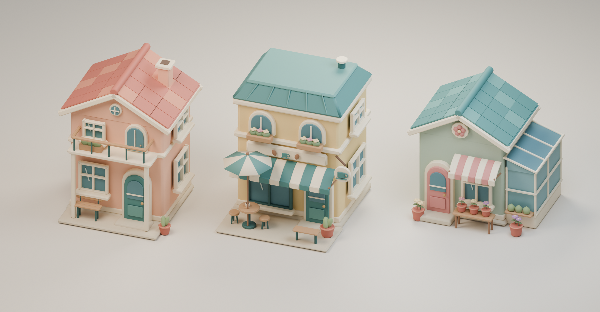
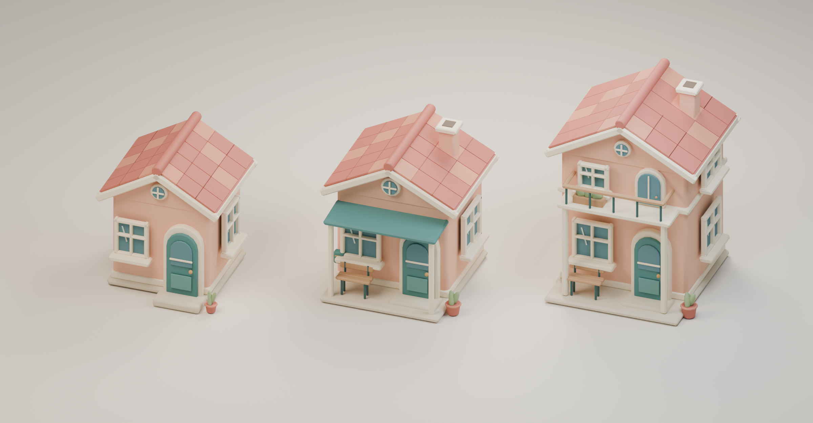
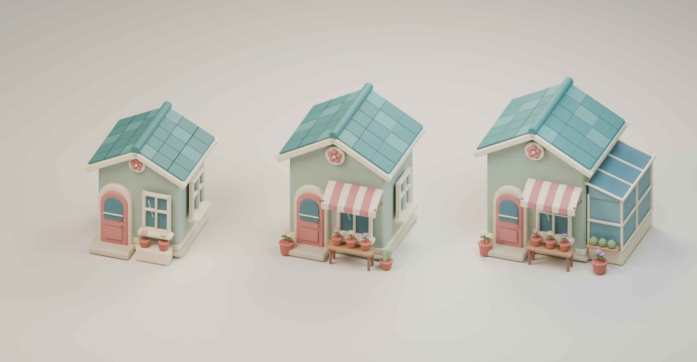

# 차곡마을 주택·꽃가게 1~3단계 v001

2026-11-09 제작. 카페 v003의 따뜻한 미니어처 스타일, 밝은 창틀, 불투명한 창문과 정점 색 기반 경량 출력 방식을 이어받은 독립 자산 세트다. 기존 카페와 최초 마을 세트는 수정하지 않았다.



왼쪽은 새 주택 3단계, 가운데는 기존 카페 v003의 3단계 GLB, 오른쪽은 새 꽃가게 3단계다. 같은 축척과 조명으로 렌더했다.

## 단계 구성

| 건물 | 1단계 | 2단계 | 3단계 |
| --- | --- | --- | --- |
| 살구색 주택 | 작은 붉은 기와집, 원형 다락창, 화분 | 지붕 있는 현관, 벤치·우편함·굴뚝 | 위층, 발코니와 출입문, 난간·화분, 아래 현관 |
| 세이지색 꽃가게 | 작은 꽃 표식과 낮은 화분 받침 | 분홍 줄무늬 차양, 꽃 진열대와 큰 화분 | 옆 온실, 유리 지붕과 진열 선반, 확장된 꽃 판매 공간 |




문자·숫자·메뉴·OPEN·글자 간판은 사용하지 않았다. 꽃가게 표식은 입체 꽃이다. 창문 뒤 갈색 보조판/덧틀을 넣지 않았다. 목재 벤치·난간·꽃 진열대와 필요한 지지대는 유지했다.

## 실제 산출물 수치

각 단계의 같은 디자인을 고밀도 부품별 편집본과 경량 GLB로 비교했다. 초기 폴리곤 목표는 단계별 4천/6천/8천 이하였고, 모두 이 상한 이하다. 공간 변화와 큰 실루엣을 우선했으며 수치를 채우기 위해 장식을 추가하지 않았다.

| 모델 | 편집본 → 런타임 삼각형 | 감소 | GLB 정점 | GLB 파일 크기 | 파일 |
| --- | ---: | ---: | ---: | ---: | --- |
| 주택 1단계 | 16,348 → **3,104** | 81.0% | 3,689 | 182,604 (178.3 KiB) | [GLB](exports/house_level_1.glb) / [렌더](renders/house_level_1.png) |
| 주택 2단계 | 21,292 → **3,872** | 81.8% | 4,635 | 228,840 (223.5 KiB) | [GLB](exports/house_level_2.glb) / [렌더](renders/house_level_2.png) |
| 주택 3단계 | 28,272 → **5,264** | 81.4% | 6,221 | 306,972 (299.8 KiB) | [GLB](exports/house_level_3.glb) / [렌더](renders/house_level_3.png) |
| 꽃가게 1단계 | 23,156 → **3,456** | 85.1% | 4,117 | 203,556 (198.8 KiB) | [GLB](exports/florist_level_1.glb) / [렌더](renders/florist_level_1.png) |
| 꽃가게 2단계 | 41,216 → **5,980** | 85.5% | 6,793 | 336,464 (328.6 KiB) | [GLB](exports/florist_level_2.glb) / [렌더](renders/florist_level_2.png) |
| 꽃가게 3단계 | 49,204 → **6,820** | 86.1% | 7,855 | 388,232 (379.1 KiB) | [GLB](exports/florist_level_3.glb) / [렌더](renders/florist_level_3.png) |

6개 GLB 모두 **불투명 mesh 1개 / material 1개 / primitive 1개 / COLOR_0 정점 색 / 외부 텍스처 0개**다. 애니메이션·카메라·광원은 GLB에 포함하지 않았다. Draco/Meshopt 압축 없이 표준 glTF 2.0으로 내보냈다.

큰 모서리에는 2분할 bevel, 작은 모서리에는 1분할을 사용하고, 기와는 얕은 큰 패널, 꽃잎은 작은 저밀도 덩어리로 만들었다. 가는 막대의 미세한 끝 bevel은 생략했다. 정점 색은 불투명 Base Color에 연결되며 거칠기는 0.68, 금속성은 0이다. 가져오는 엔진에서 COLOR_0을 유지해야 모델 색이 보인다. 뒷면 컬링을 사용한다.

이 수치는 모델의 정적 비용이다. 실제 엔진의 그림자·깊이 패스를 포함한 draw call이나 차량 프레임 속도·GPU 메모리·발열을 측정한 결과는 아니다.

## 편집 원본

[chagok_house_florist_v001.blend](blend/chagok_house_florist_v001.blend)에 총 15개 장면이 있다.

- `01 • House upgrades`: 경량 주택 3단계 비교.
- `02 • Florist upgrades`: 경량 꽃가게 3단계 비교.
- `03 • Neighborhood style`: 주택·기존 카페 v003·꽃가게의 같은 축척 비교.
- `EDIT • house_level_1/2/3`, `EDIT • florist_level_1/2/3`: 지붕·기와·문·창·발코니·꽃·온실 등 이름 붙인 부품별 편집본.
- `RUNTIME • house_level_1/2/3`, `RUNTIME • florist_level_1/2/3`: 실제 내보내기에 사용한 병합 경량 모델.

편집본의 재질과 모디파이어를 수정할 수 있다. 편집본을 손으로 고친다고 이미 병합한 런타임 메시가 자동 갱신되지는 않는다. 재생성할 변경은 소스에 반영하거나 정점 색 저장·병합·내보내기를 다시 수행한다. 모든 팔레트는 [palette.json](reports/palette.json)에 있다.

## 축척·공통 부지

Blender의 1 unit은 1 m, 위쪽은 +Z, 정면은 -Y다. 업그레이드 전후 루트는 **건물 몸체 중심의 바닥 (0,0,0)**, scale=(1,1,1)을 유지한다. GLB는 표준 Y-up으로 저장한다.

주택과 꽃가게 모두 최고 단계의 기와·현관·발코니·화분·온실 돌출부를 포함해 **4.8×4.8 m** 공통 배치 구역을 사용한다. 루트 기준 XY 범위는 **(-2.4,-3.2)~(2.4,1.6)**이다. 앞쪽 공간을 더 확보한 구역이며 루트 양쪽으로 ±2.4 m라는 뜻은 아니다. 카페 v003와 같은 계약이며 GLB extras에도 기록했다.

## 검증 결과

- `.blend`를 별도 프로세스에서 다시 열어 15개 장면 확인.
- 편집본과 병합 전 경량본의 각 메시가 닫혀 있고 양의 signed volume을 갖는지 검사해 뒤집힌 고립 부품과 열린 면을 확인.
- GLB 6개를 각각 빈 장면으로 재가져오기. 메시/재질/primitive/삼각형 수와 정점 색의 실제 값 집합이 원본 경량 모델과 일치.
- 원본·재가져오기 사이의 삼각형 정점 좌표와 **면의 순환 방향**을 비교. 면을 반대로 뒤집으면 통과하지 않는 검사다. 가져온 노멀은 유한한 단위벡터인지 확인.
- 바닥 높이, 원점·단위 축척, 바운딩박스, 공통 부지 범위와 단계별 삼각형 상한 통과.
- 문자 객체 0개, 갈색 창문 보조판 0개, GLB 외부 텍스처 0개 확인.
- **3개 기존 폴더의 75개 파일**을 SHA-256으로 확인했다: `town_miniature_v001`, `town_cafe_v002`, `town_cafe_v003`. 모두 그대로다.

단계별 비교 2장, 카페 포함 스타일 비교 1장, 실제 GLB 재가져오기 개별 렌더 6장, 3단계 뒷면 2장을 실제로 열어 검수했다. 대표 결과는 `renders/01_house_levels.png`, `02_florist_levels.png`, `03_style_with_cafe_v003.png`다. `preview_*`는 최종 검수 전 중간 시안이다.

원자료: [model_stats.json](reports/model_stats.json), [validation.json](reports/validation.json), [기존 파일 해시](reports/previous_versions_sha256.json). `docs/`와 Android 코드를 수정하지 않았으며 Pleos/실차 성능·게임 재미는 이번 작업에서 검증하지 않았다.

## 재현

- [build_set.py](source/build_set.py): 6개 모델, 편집·경량 장면과 GLB·통계 생성.
- [geometry.py](source/geometry.py): 카페 v003에서 필요한 공통 모델링 함수를 독립 복사한 제작 소스.
- [render_verify.py](source/render_verify.py): 재열기·재가져오기·노멀·정점 색·부지·보존 검사와 렌더.
- [write_report.py](source/write_report.py): 측정값으로 이 제작 기록 생성.

```powershell
$blender = 'C:/Users/hy/AppData/Local/Programs/Blender Foundation/blender-5.2.3-windows-x64/blender.exe'
& $blender --background --python 'D:/Project/Etc/ChagokTown/art/town_house_florist_v001/source/build_set.py'
& $blender --background --python 'D:/Project/Etc/ChagokTown/art/town_house_florist_v001/source/render_verify.py'
& 'C:/Users/hy/.codex/tools/blender-mcp/2.2.7/venv/Scripts/python.exe' 'D:/Project/Etc/ChagokTown/art/town_house_florist_v001/source/write_report.py'
```

Blender 5.2.3 LTS, Cycles 64 samples + denoise, RTX 3060 OptiX로 최종 렌더했다. 비교는 2400×1250, 개별·뒷면은 1200×1200이다. 재생성은 이 버전의 산출물을 덮어쓰므로 수동 편집본은 별도 이름으로 보존한다. 기존 파일 해시가 달라지면 자동으로 덮어쓰거나 복구하지 않고 빌드를 중단한다.
