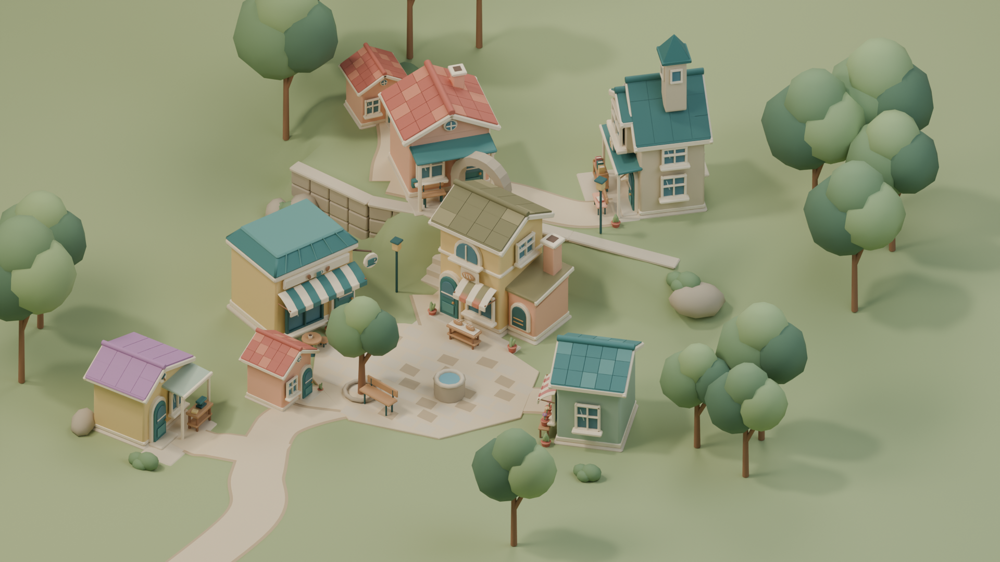
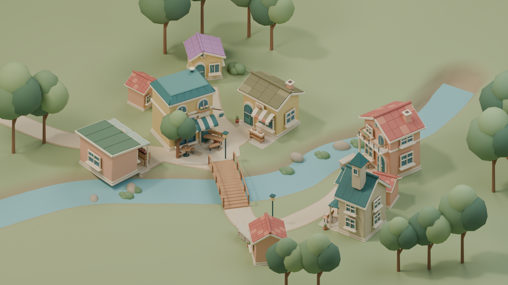

# 차곡마을 — 전체 구도 비교 A / B

2026-11-09. **완성된 게임 마을이 아닌, 전체 공간 구도를 비교하는 3D 시안 두 개**다. 거절된 `town_layout_v001`의 타원 판·두 줄 배열·등간격 슬롯·외곽 순환로는 사용하지 않았다. 기존 단품 3단계 추가 제작과 납품 마무리는 계속 보류했다.

최우선 기준은 [사용자가 직접 고른 Tiny Glade 이미지](../reference/town_layout_2026_11_09/user_selected_tiny_glade.png)다. [레퍼런스 분석](../reference/town_layout_2026_11_09/README.md)의 Townscaper·Palia는 군집·열린 공간·계단 관찰을 위한 보조 자료로만 썼다. 원본 건축물이나 성·성당의 형태를 복제하지 않았다.

## A — 언덕의 작은 상점 광장



세 가게가 비정형 공동 광장을 감싼다. 한쪽 골목은 낮은 공방으로 내려가고, 뒤쪽 계단·옹벽·작은 돌 아치를 지나 집과 높은 책방이 있는 테라스로 올라간다. 작은 집 두 채는 기존 주택의 크기가 다른 사본이며 별도의 새 건물/업그레이드 에셋이 아니다. 총 8개 건물 인스턴스다.

- **읽히는 관계:** 광장 → 계단과 아치 → 높은 책방, 그리고 아래쪽 작업 골목. 지형의 두 높이와 지붕 겹침이 한 장면 안에서 구역을 구분한다.
- **남는 차이:** 사용자 이미지의 연속된 벽·촘촘한 지붕 덩어리보다 여유 공간이 크다. 기존 단품의 두꺼운 창틀과 색 때문에 더 장난감 같은 인상이 남는다. 작은 광장 중심과 위쪽 책방이 시선을 나눠 가지는 것도 다음 선택에서 볼 부분이다.

[A 탑뷰](renders/A_top.png)

## B — 다리에서 이어지는 시냇가 마을



한쪽 강변에 카페·빵집·식료품점과 작은 옛 골목을 모았다. 목조 다리를 건너면 굽은 주거 골목이 집·작은 집·높은 책방으로 이어진다. 공방은 상점 뒤쪽의 조용한 공간이다. 총 9개 건물 인스턴스이며 건물 수를 균등 배치하는 기준으로 삼지 않았다.

- **읽히는 관계:** 상점 마당 → 다리 → 굽은 주거 골목. 물길이 두 군집의 경계와 연결 지점을 함께 만든다. 입구를 카메라에 맞춰 줄 세우지 않아 일부 건물은 옆면·뒷면이 보인다.
- **남는 차이:** 사용자 이미지보다 두 강변 군집의 분리가 크고 수로 주변 여백이 넓다. 전경 작은 집과 식생은 일부 겹친다. 큰 덩어리의 위치를 비교하는 시안이며 실제 게임 선택 영역/오클루전 처리를 완료했다는 뜻은 아니다.

[B 탑뷰](renders/B_top.png)

## 시각 검수와 수정

첫 사선·탑뷰를 실제로 열었을 때 독립 건물 전시처럼 보이는 간격, 큰 나무의 가림, 각진 잔디 패치와 강둑, 지형에 파묻히는 길이 남았다. 그 상태로 마무리하지 않고 다음을 수정한 뒤 최종 네 이미지를 다시 열어 확인했다.

1. 기존 작은 주택 사본을 골목과 위쪽 주거 구역의 틈에 배치하고, 건물 앞의 별도 샘플 마당 가장자리는 공동 포장에 일부 묻어 연결했다. 동일한 크기의 사각 잔디 부지는 만들지 않았다.
2. 책방 사본은 따뜻한 석벽 색면, 높아진 상층과 작은 뾰족 지붕 전망부로 중심 실루엣을 보정했다. 빵집 사본의 큰 지붕·차양 색면은 올리브/갈색으로 바꿨다. **이 폴더의 장면 사본만 변경했고 원본 GLB는 보존했다.** 이 시안의 변형을 새 3단계 세트로 완성한 것은 아니다.
3. 공동 광장은 큰 포장 색면과 성긴 돌 패치만 사용했다. 나무 아래는 별도 다각형 판을 없애고 지형 정점색에 섞었다. 나무를 외곽의 같은 간격 배열 대신 숲 덩어리로 묶었다.
4. 접근 골목을 시냇물 안으로 내려가지 않게 옮기고, 강변 마당을 돌 옹벽으로 받쳤다. 물은 지형 아래까지 충분히 이어서 검은 틈이 나지 않게 했다.
5. 길의 가로·세로 표본을 늘리고 실제 지형 메시의 BVH 표면에 맞춰, 지형이 길 위로 뚫고 나오는 부분을 정리했다. 겹치는 골목 면에는 작은 높이 차이를 두고 길 자체의 근접 자기 그림자를 껐다. 건물의 그림자는 받는다. 이는 비교용 표면 레이어이며 실제 런타임에서는 도로 면을 일체화하는 후속 작업이 필요하다. 기본 렌더의 심도 흐림은 껐다.

사용자 이미지에서 느껴지는 오래된 마을의 재질·밀도에 완전히 도달했다고 판정하지 않는다. 두 안 중 공간의 뼈대를 비교한 뒤, 어느 부분의 밀도를 높이거나 핵심 건물 비례를 더 바꿀지 판단하는 용도다.

## 파일과 확인 범위

- [편집 가능한 Blender 원본](blend/chagok_layout_v002_concepts.blend): `A • composition concept`, `B • composition concept`, 읽기 전용 원본 캐시 장면. 건물 인스턴스의 이동/각도/크기와 지형·길·옹벽·조경 부품을 편집할 수 있다.
- [배치 데이터](source/layouts.json), [배치·지형·렌더 소스](source/build_concepts.py), [형태 함수 독립 사본](source/geometry.py), [현재 브리프](reports/brief.md).
- 사선 두 장은 같은 **1920×1080, 16:9, 정사영 28 m**다. 조명과 카메라 방향은 같고 프레임 중심만 구도에 맞게 조정했다. 탑뷰는 같은 1920×1080, 정사영 35 m다. Cycles 64 samples, GPU, 심도 흐림 없음.
- `.blend`를 저장한 뒤 다시 열어 네 렌더를 만들었다. 단품을 기존 스크립트로 재생성하지 않고 실제 기존 GLB를 읽었다.
- 건물별 **최대 단계의 실제 정점을 XY에 투영한 convex hull**을 배치 변환 후 비교했다. 총 64쌍의 분리축 검사에서 겹침 0개다. 공통 4.8 m 사각형은 배치 기준으로 쓰지 않았다. 이는 보수적인 2D 외곽 검사이며 내부 소품·동적 캐릭터·엔진 충돌/경로 찾기의 완료를 뜻하지 않는다. 책방 전망부의 XY는 원본 최대 외곽 안인지도 확인했다.
- 사용한 GLB와 기존 `town_layout_v001`의 읽기 전용 입력 32개는 실행 시작/종료 SHA-256이 같았다. docs와 다른 작업자의 파일은 수정하지 않았다.

검사: [구도 확인](reports/composition_checks.json), [최대 외곽](reports/layout_checks.json), [입력 해시](reports/read_only_inputs.json), [새 색 역할](reports/palette.json), [최종 로그](reports/final.log).

**앱 통합, 마을 전체 GLB 패키징, 차량/Android 성능, 전체 24종 재검증은 수행하지 않았다.** 비교 장면은 지형과 편집용 원본 캐시를 포함하므로 런타임 납품 패키지가 아니다. 단품의 기존 업그레이드 규칙과 차량용 경량화 요구를 폐기하거나 사용자 미감 승인을 받았다는 의미도 아니다.

## 재현

```powershell
& 'C:/Users/hy/AppData/Local/Programs/Blender Foundation/blender-5.2.3-windows-x64/blender.exe' --background --python-exit-code 1 --python 'D:/Project/Etc/ChagokTown/art/town_layout_v002_concepts/source/build_concepts.py'
python -B 'D:/Project/Etc/ChagokTown/art/town_layout_v002_concepts/source/write_readme.py'
```

`-- --preview`는 빠른 별도 preview PNG를 만든다. `-- --layout-check`는 최대 외곽만 검사하고 종료한다. 생성 명령은 이 폴더의 비교 산출물을 덮어쓰므로 수동 편집 사본은 먼저 별도 보관한다. 기존 에셋·docs·v001은 쓰지 않는다.
