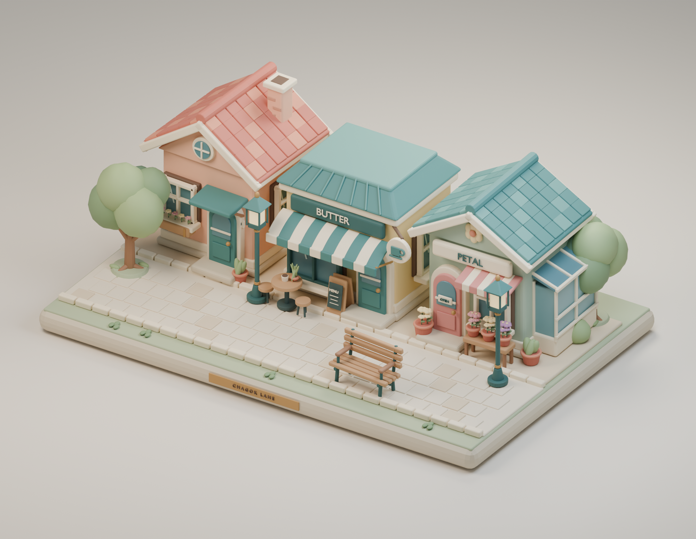

# 차곡마을 미니어처 아트 시제품 v001

제작일: 2026-11-09. 사용자 요청: “약간 아기자기 미니어쳐 느낌나는 만화풍으로”.

작은 주택·카페·꽃가게와 둥근 나무·나무 벤치·가로등 총 6종의 실제 3D 모델이다. 두꺼운 지붕, 둥근 모서리, 돌출된 창틀, 화분과 간판을 같은 따뜻한 팔레트로 구성했다. 스타일 검토용 첫 시제품이며 최종 채택된 아트는 아니다. 기존 ART_GUIDE의 2D 마스코트 전용 제약은 이번 건물 제작에 적용하지 않았다.



## 파일

- [편집 가능한 Blender 원본](blend/chagok_town_miniature_v001.blend)
- [6종 비교 렌더](renders/03_asset_set.png)
- [골목 반대쪽 사선 렌더](renders/02_diorama_reverse.png)
- [생성 소스](source/build_town.py), [렌더 소스](source/render_town.py), [검증 소스](source/verify_assets.py)
- [모델 통계](reports/model_stats.json), [팔레트](reports/palette.json), [재가져오기 검증 결과](reports/validation.json)

| 모델 | GLB | 개별 렌더 | 메시 객체 수¹ | 삼각형 수² | 재질 수 |
| --- | --- | --- | ---: | ---: | ---: |
| 살구색 주택 | [house.glb](exports/house.glb) | [PNG](renders/asset_house.png) | 186 | 36,748 | 20 |
| 버터 카페 | [cafe.glb](exports/cafe.glb) | [PNG](renders/asset_cafe.png) | 97 | 26,232 | 17 |
| 꽃가게 | [flower_shop.glb](exports/flower_shop.glb) | [PNG](renders/asset_flower_shop.png) | 303 | 52,792 | 23 |
| 둥근 나무 | [round_tree.glb](exports/round_tree.glb) | [PNG](renders/asset_round_tree.png) | 15 | 4,616 | 5 |
| 나무 벤치 | [wood_bench.glb](exports/wood_bench.glb) | [PNG](renders/asset_wood_bench.png) | 26 | 3,960 | 4 |
| 가로등 | [street_lamp.glb](exports/street_lamp.glb) | [PNG](renders/asset_street_lamp.png) | 14 | 2,740 | 4 |

¹ GLB 재가져오기 후의 메시 객체 수. 원본의 글자는 편집 가능한 FONT이며 GLB에서는 입체 메시가 된다.
² bevel·solidify 등 모디파이어 평가 후 실제 내보낸 수. 6종 합계 127,088 triangles / 641 mesh objects. 디오라마의 반복 배치·포장·받침대는 이 합계에 포함되지 않는다.

## Blender에서 편집하기

원본을 열면 `01 • Chagok Lane` 장면이다. 상단 Scene 선택에서 다음 개별 편집 장면으로 바꿀 수 있다.

- `02 • Edit house`
- `03 • Edit cafe`
- `04 • Edit flower_shop`
- `05 • Edit round_tree`
- `06 • Edit wood_bench`
- `07 • Edit street_lamp`

각 `ASSET` 컬렉션을 펼치면 지붕·벽·문·창·화분·꽃잎·간판·벤치 판재 등이 의미별 이름을 가진 개별 객체로 들어 있다. bevel 모디파이어와 재질 슬롯은 원본에 남겨 두었다. 골목은 같은 컬렉션을 인스턴스로 사용하므로 개별 장면에서 고친 모델이 골목에도 반영된다. 디오라마 카메라와 조명은 원본에 포함된다. 건물 내부는 제작 범위에 포함하지 않았으며, 유리는 투명 내부 대신 불투명한 만화풍 유리 재질로 표현했다.

## 축척과 배치 기준

- Blender: 1 unit = 1 m, +Z 위, 정면 -Y.
- 모든 자산 루트: 위치 (0, 0, 0), scale (1, 1, 1). 건물 몸체 또는 소품 주축의 바닥 중심을 배치 기준으로 사용한다. 돌출 장식까지 포함한 바운딩박스의 가로 중심과는 다를 수 있다.
- 모든 자산의 실제 최저 메시 정점을 Z=0에 정렬했다. 재가져오기 후 최대 바닥 오차는 1.5×10⁻⁸ m 미만이었다.
- GLB: 표준 glTF 2.0, Y-up 변환 적용. Blender로 재가져오면 원래 축과 치수가 복원된다.
- 재질은 Principled BSDF의 색·거칠기·금속성·발광이다. 외부 이미지, 텍스처, 유료 생성 서비스, 다운로드한 3D 자산은 사용하지 않았다. 창문 반사와 글자도 메시다.

## 재현

Blender 5.2.3 LTS의 Python/bpy로 제작했다. 다음 명령은 해당 버전 폴더의 산출물을 다시 생성하므로 원본을 손으로 수정한 뒤 실행하면 수정본을 덮어쓴다. 수동 편집본은 다른 파일로 저장한다.

```powershell
$blender = 'C:/Users/hy/AppData/Local/Programs/Blender Foundation/blender-5.2.3-windows-x64/blender.exe'
& $blender --background --python 'D:/Project/Etc/ChagokTown/art/town_miniature_v001/source/build_town.py'
& $blender --background --python 'D:/Project/Etc/ChagokTown/art/town_miniature_v001/source/render_town.py'
& $blender --background --python 'D:/Project/Etc/ChagokTown/art/town_miniature_v001/source/verify_assets.py'
```

Cycles / NVIDIA GeForce RTX 3060 OptiX로 렌더했다. 골목 2장 2000×1550, 비교 1장 2200×1600은 64 samples, 개별 6장 1100×1100은 48 samples와 denoise를 사용했다. `TOWN_RENDER_MODE` 환경 변수를 `preview`, `hero`, `individual`, `set`, `all`로 지정할 수 있고 기본값은 `all`이다. `renders/preview_diorama.png`는 바닥 정렬 보정 전 구도 확인용이며 납품 대표는 `01_diorama.png`다. `reports/render_preview.log`에는 최종 전체 렌더 실행 기록이 남아 있다.

## 검증 결과와 범위

- `.blend` 저장 후 별도 Blender 프로세스에서 재열기 성공. 장면 7개, 원본 객체 839개, 원본 메시 809개, 편집 가능한 글자 객체 6개 확인.
- GLB 6종 각각 빈 장면으로 재가져오기 성공. 각 파일의 메시 수·삼각형 수·재질 수가 평가된 원본과 일치했다.
- 실제 정점 좌표로 계산한 원본/재가져오기 바운딩박스 최대 차이 3×10⁻⁸ m 미만. 루트 위치·축척·바닥 정렬·유한 좌표 검사 통과.
- GLB 헤더·파일 길이 확인. 이미지 의존성 0개 확인. 검사 원자료는 `reports/validation.json`이다.
- 최종 골목 렌더 2장, 비교 렌더 1장, 개별 렌더 6장을 실제로 열어 외곽 잘림, 주요 부품, 색, 접지와 그림자를 확인했다.
- 검증한 대상은 **3D 파일과 렌더**다. Android 앱 연결, 실시간 draw call/메모리/프레임 측정, Pleos·실차 성능, 반복 플레이 재미는 이번 작업에서 검증하지 않았다. 현재는 편집성을 위해 부품을 많이 분리한 아트 시제품이며 런타임 최적화판이 아니다.

작업은 `art/town_miniature_v001/` 안에서 수행했다. 기존 캐릭터 에셋과 Android 앱 코드는 변경하지 않았다.
