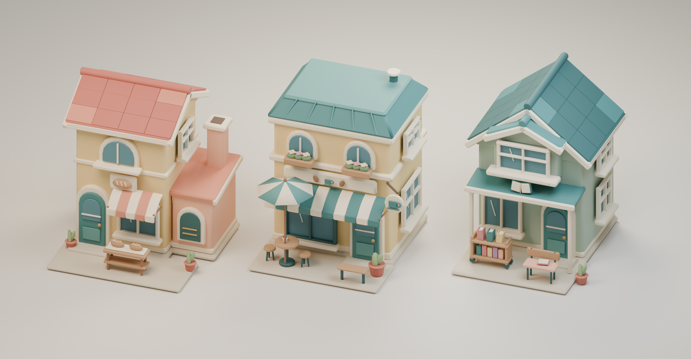

# 차곡마을 — 빵집·책방 1~3단계 v001

2026-11-09. 기존 카페 v003와 주택·꽃가게 v001을 기준으로 제작한 새 건물 샘플 6개다. 기존 에셋·문서와 Android 코드는 수정하지 않았다. 최종 채택은 사용자의 결과 검토 대상이다.



## 디자인과 기준의 관계

- **빵집:** 좌측 입구와 우측 진열창이 있는 작은 가게 → 넓어진 진열창·크림/살구 차양·빵 판매대와 앞마당 → 상층 베이킹 창·별도 오븐 공간·두툼한 굴뚝. 카페와 다른 가로 방향 용마루와 테라코타 지붕을 사용했다.
- **책방:** 책 그림 표식이 있는 세이지색 작은 서점 → 이동식 외부 책 진열대·벤치·기둥이 있는 단단한 현관 지붕 → 높은 다락과 앞으로 돌출된 열람창·작은 앞지붕. 진열된 책과 표식에는 글자가 없다.
- **유지한 점:** 기준 팔레트, 아이보리 창틀, 청록 문과 불투명 창, 두꺼운 지붕, 낮은 분할 수의 부드러운 모서리, 넓은 색면, 같은 축척·조명·중립 배경.
- **차이:** 빵집은 더 넓고 낮은 별채가 붙는 비대칭 구성이다. 책방은 카페보다 뾰족하고 높은 박공과 다락창으로 수직 실루엣이 강조된다. 카페의 파라솔·꽃상자와 같은 장식 밀도는 반복하지 않았다. 새 건물의 문·기본 창틀은 동네 공통 어휘를 재사용한다.
- 빵 표식과 진열 빵은 첫 검수에서 대비가 약해 기존 `Wood light #BB9065`로 빵 껍질을 조정했다. 이 색은 목재에도 쓰지만 빵에는 무늬 없이 무광 색면으로 사용한다. 새 팔레트 색은 추가하지 않았다.

## 납품 파일

- [부품별 편집 Blender 원본](blend/chagok_sol_bakery_bookshop_v001.blend): 비교 장면 3개 + 편집 장면 6개 + 런타임 장면 6개, 총 15개. 편집 원본은 의미 있는 이름을 가진 개별 부품과 비파괴 bevel을 유지한다. 불필요한 고밀도 버전 없이 납품 모델과 정확히 같은 형태를 편집할 수 있다.
- 단계 비교: [빵집](renders/01_bakery_levels.png), [책방](renders/02_bookshop_levels.png).
- [카페 v003 옆 스타일 비교](renders/03_style_with_cafe_v003.png): 모두 실제 GLB를 불러온 같은 축척의 장면이다.
- 개별 사선: [빵집 1](renders/bakery_level_1.png) / [2](renders/bakery_level_2.png) / [3](renders/bakery_level_3.png), [책방 1](renders/bookshop_level_1.png) / [2](renders/bookshop_level_2.png) / [3](renders/bookshop_level_3.png).
- 최고 단계 뒤쪽 사선: [빵집](renders/bakery_level_3_back.png), [책방](renders/bookshop_level_3_back.png).

## 최종 GLB 통계

| 모델 / 다운로드 | 삼각형 | GLB 정점 | 크기 bytes | 정점 색 종류 |
| --- | ---: | ---: | ---: | ---: |
| [빵집 1단계](exports/bakery_level_1.glb) | 3,484 | 4,106 | 203,208 | 13 |
| [빵집 2단계](exports/bakery_level_2.glb) | 4,948 | 5,770 | 285,224 | 16 |
| [빵집 3단계](exports/bakery_level_3.glb) | 7,172 | 8,221 | 406,412 | 17 |
| [책방 1단계](exports/bookshop_level_1.glb) | 2,764 | 3,472 | 171,016 | 10 |
| [책방 2단계](exports/bookshop_level_2.glb) | 5,008 | 6,285 | 308,252 | 14 |
| [책방 3단계](exports/bookshop_level_3.glb) | 7,256 | 8,865 | 435,252 | 18 |

각각 **메시 1개 / 재질 1개 / primitive 1개**, `COLOR_0` 정점색, 텍스처·외부 이미지 0개다. 불투명, 금속성 0, 거칠기 0.68, 뒷면 컬링을 유지한다. GLB 정점 수는 색·노멀 경계에서 분할된 수이며 편집 메시 정점 수와 다를 수 있다. 내부적으로 겹쳐 조립된 닫힌 부품은 합쳐진 한 메시 안에서 별도 연결 성분으로 남는다. Boolean으로 모든 부품을 한 덩어리로 봉합한 모델이라는 의미는 아니다.

초기 삼각형 상한 4,000 / 6,000 / 8,000을 모두 지켰다. 이것은 제작 예산이며 실차 성능 보장 수치가 아니다.

## 좌표와 사용

Blender 1 unit = 1 m, +Z 위, 정면 -Y. 모든 단계의 루트는 `(0,0,0)`, scale `(1,1,1)`이다. 부지 전체는 **XY (-2.4,-3.2)~(2.4,1.6) m**로 앞쪽 여백이 큰 공통 4.8×4.8 m다. 부지가 모델마다 꽉 차야 한다는 뜻은 아니며 최고 단계 처마·화분·현관·별채도 범위 안이다. GLB의 Y-up 변환과 재가져온 Blender 좌표 복원을 검사했다.

런타임 재질에서 `COLOR_0`을 기본색에 반영해야 한다. 투명 유리나 텍스처가 필요하지 않다. 비교용 바닥·카메라·조명은 GLB에 포함하지 않았다. 한 primitive가 엔진 전체의 단일 draw call을 보장하지 않는다.

## 파일·시각 검증

- 별도 Blender 프로세스에서 `.blend` 재열기, 개별 GLB 6개를 각각 빈 장면에 재가져오기 통과.
- 원본의 닫힌 부품, 일관된 면 방향과 양의 체적 확인. 원본·최종 GLB·재가져온 메시의 유한한 단위 길이 노멀, 퇴화 삼각형 0개 확인.
- 실제 GLB의 좌표·삼각형 방향을 원본과 비교하고 정점색 집합이 같은지 확인. 바닥·범위·루트·축척·재질도 통과.
- 최종 납품 GLB를 재가져온 뒤 단계 비교 2장, 스타일 비교 1장, 개별 사선 6장, 최고 단계 뒤쪽 2장을 렌더했다. 실제 이미지 열기와 판정은 [시각 검수 기록](reports/visual_review.md)에 남겼다.
- 문자 객체와 갈색 창문 보조판은 없다. 창문에는 유리·아이보리 창틀·창턱만 사용한다. 목재 진열대와 빵에 쓰인 갈색은 별도 역할이다.
- 기존 기준 에셋과 프로젝트 문서 118개 파일의 SHA-256이 작업 시작 당시와 일치했다. [보존 기준](reports/protected_files_sha256.json).

검사 원자료: [최종 검증](reports/validation.json), [모델 통계](reports/model_stats.json), [팔레트](reports/palette.json), [생성 로그](reports/build.log), [검증·렌더 로그](reports/render.log).

이 결과는 **3D 파일·오프라인 렌더 검증**이다. Android 앱 연결·에뮬레이터 프레임 성능·Pleos·실차의 메모리/발열/프레임 속도와 사용자 재미는 이번 작업에서 검증하지 않았다. Cycles의 접지 그림자·조명은 런타임 품질을 입증하지 않는다.

## 제작 출처와 재현

- 작업 지시: [제작 요청 기록](reports/production_brief.md). 요청된 세션 설정은 GPT-6.1 Sol / xhigh이며 제작 도구는 Codex와 Blender 5.2.3 LTS다.
- 기준: 마을 아트 스타일 문서(비공개), [카페 v003](../town_cafe_v003/README.md), [카페 단계 렌더](../town_cafe_v003/renders/01_cafe_levels.png), [주택·꽃가게와 카페 비교](../town_house_florist_v001/renders/03_style_with_cafe_v003.png).
- `source/geometry.py`는 `town_house_florist_v001/source/geometry.py`에서 가져온 독립 사본이다. 원본 함수에 반영된 얇은 판 bevel 제한을 유지했고, 이 사본에서만 창틀 가로 부재를 12~13 mm 앞으로 옮겨 같은 평면의 표면 겹침을 제거했다. 기존 원본은 수정하지 않았다. 내보내기·재가져오기·조명 절차를 참고했고 새 건물의 형태와 장면 구성은 이 폴더의 [build_set.py](source/build_set.py)에 있다.
- 이미지 생성·외부 모델·텍스처 다운로드는 사용하지 않았다. 모델은 실제 메시 부품으로 제작했다.
- [검증·렌더 소스](source/render_verify.py), [README 생성](source/write_report.py).

```powershell
& 'D:/Project/Etc/ChagokTown/art/town_sol_bakery_bookshop_v001/source/run.ps1'
python -B 'D:/Project/Etc/ChagokTown/art/town_sol_bakery_bookshop_v001/source/write_report.py'
```

`run.ps1 -Preview`는 빠른 비교 렌더와 별도 `validation_preview.json`만 만든다. 최종 납품 검증은 인자 없는 실행이다. 모든 Blender Python 실행에 `--python-exit-code 1`을 사용하고 실패 시 후속 단계를 중단한다. 이 명령은 이 버전의 생성 산출물을 덮어쓰므로 수동 편집 사본은 먼저 별도 보관한다. 기존 버전 스크립트는 실행하지 않는다.
